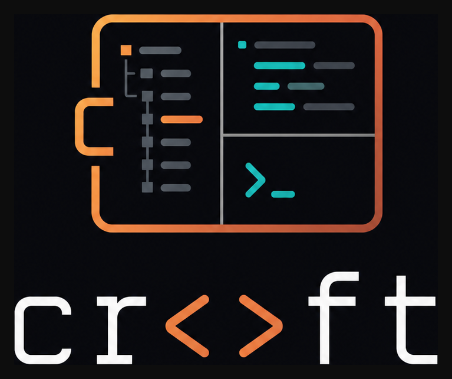
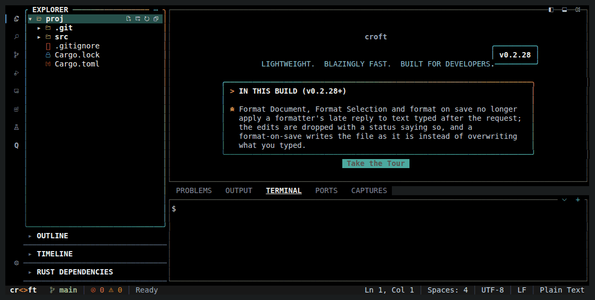

<div align="center">
  
</div>

# croft

A VS Code style three pane workspace that runs entirely inside your terminal. Written in Rust, shipped as a single static binary.

## Tenets

The non-negotiables behind every decision in croft:

1. **croft starts in milliseconds. No exceptions.** From any terminal, any launcher, on any workspace, the first frame is up in milliseconds. Nothing the first frame does not need runs before it: shell probes, image baking, indexing, and network checks all happen after it, off the UI thread.
2. **Speed is a must.** Every feature is weighed against its cost on the hot path before it lands.
3. **Low latency is non-negotiable.** Keystrokes and clicks register instantly; rendering is coalesced so a noisy shell can never starve input.
4. **Local and remote parity always binds.** Behaviour on your Mac and on a Linux box over SSH is identical. There is no second-class remote mode.
5. **The gap between terminal and GUI stays minimal.** croft should look and feel like VS Code, down to the icons and motion.
6. **Everything has a shortcut.** Every action is reachable from the keyboard, and no menu item ships without an accelerator.
7. **Correctness beats workarounds.** Bugs are fixed at the root, never papered over with a fallback or a downgrade.
8. **One binary, no ceremony.** Features are emulated in process rather than bolted on, so there is nothing to wire up after you install.

## Layout



Three panes in the VS Code arrangement: an **Explorer sidebar** on the left, a **code editor** top right, and a **panel** bottom right with PROBLEMS, OUTPUT, TERMINAL, CAPTURES, and PORTS tabs. An activity bar down the far left switches the sidebar between Explorer, Search, Source Control, Remote (SSH), Run and Debug, Extensions, and Testing, and holds the theme picker. Every seam drags to resize, and a **Customize Layout** popup mirrors VS Code's title-bar controls.

The essentials are all there: full LSP editing (completion, hover, go-to-definition, rename, quick fixes, inlay hints) with tree-sitter highlighting, multi-cursor, minimap, git gutter, inline blame, and an optional vim mode; a real terminal with shell integration, splits, triggers, copy mode, and durable command history; Source Control with hunk staging and a commit graph; a Test Explorer; a zero-config task runner; Live Run, which re-runs a Python file as you type and shows every line's values inline; and debugging for Python, JavaScript/TypeScript, Rust, C, and C++ over DAP.

See **[LAYOUT.md](docs/LAYOUT.md)** for the pane-by-pane reference: every editor, terminal, Source Control, Testing, and status-bar feature, the debugging workflow, and language-server setup.

## Requirements

| Requirement | Why |
|-------------|-----|
| macOS, Linux, or Android (Termux) | The PTY layer is POSIX. On Windows, run the Linux build inside WSL2; see [WINDOWS.md](docs/WINDOWS.md). |
| Rust 1.93+ stable and a C compiler | Only to build from source (edition 2024; the tree-sitter grammars compile C). See [Install Rust](docs/INSTALL.md#install-rust). |
| A Nerd Font as your terminal font | File and activity-bar icons are Nerd Font glyphs; without one they render as `[?]` boxes. |
| A 256 color or truecolor terminal | Terminal.app, iTerm2, Alacritty, kitty, WezTerm, and Ghostty all qualify. |
| iTerm2, WezTerm, Ghostty, kitty, or a sixel terminal (optional) | Inline image / PDF / spreadsheet previews. Elsewhere croft shows a metadata header line. |
| `pdftoppm` from poppler-utils (optional) | Multi-page PDF preview with clickable links. Without it, page 1 only on macOS via `sips`. |
| Node.js + npm (optional) | TypeScript / JavaScript LSP; croft auto-installs the `vtsls` server on first use. |

Per-platform setup (Nerd Font, terminal keybindings, optional dependencies) lives in the [platform guides](#platform-setup).

## Install

```bash
brew install vitali87/croft/croft
```

Homebrew on macOS or Linux installs a prebuilt binary, with no toolchain and no compile.
`cargo binstall croft-software` or a plain `curl | tar` of the release archive gets the same
binary, and `cargo install croft-software --locked` builds it from source.

See **[INSTALL.md](docs/INSTALL.md)** for every method, upgrading, and verifying a release's
signature.

## Run

`croft` opens the current directory, and `croft <folder>` any other. `croft remote <host>` runs
it on a Linux server over SSH, installing itself there on first connect, and `croft devcontainer`
runs it inside a folder's dev container.

See **[CLI.md](docs/CLI.md)** for the commands you will reach for most; `croft --help` lists them all.

## Collaboration

`croft attach` keeps a session alive after you close the window, and lets other people join it.
Add `--solo` and each participant gets an independent viewport on the same files, live. An AI can
take a seat too, either as an MCP guest or as a resident pair-programming navigator croft hosts
itself (`croft pair`), local open-weight models included.

See **[COLLABORATION.md](docs/COLLABORATION.md)** for the full guide.

## Platform setup

croft runs on macOS, Linux, Android, and Windows (via WSL2). The cross-platform basics are above; each platform has a short guide for its Nerd Font, terminal keybindings, and optional dependencies:

* **[macOS](docs/MACOS.md)** — Nerd Font for Terminal.app, and `croft setup-iterm2` / `croft setup-ghostty` to deliver the `Cmd` chords that macOS otherwise reserves for menus.
* **[Linux](docs/LINUX.md)** — `Ctrl` as the command modifier, Nerd Font and poppler-utils, language servers, and the `croft remote <host>` cross-compile / provisioning flow.
* **[Android (Termux)](docs/ANDROID.md)** — `Ctrl` as the command modifier, `pkg`-based dependencies, the auto-installed activity-bar font, and the built-in on-screen keyboard for touch.
* **[Windows (WSL2)](docs/WINDOWS.md)** — run the Linux build inside WSL2, hosted in WezTerm for the full icon/image UI; why native PowerShell / conhost is not supported.

## Keybindings

Every action is reachable from the keyboard; press `F1` inside croft for the full reference. The complete tables (global, Explorer, Search, editor, vim mode, previews, terminal) live in **[KEYBINDINGS.md](docs/KEYBINDINGS.md)**. The command modifier is `Cmd` on macOS and `Ctrl` on Linux / Android, where `Ctrl`+`K` is also the `Cmd+K` chord leader; the [platform guides](#platform-setup) cover getting `Cmd` chords through your terminal and the few Linux chords that need `Super`.

## Goal

A complete VS Code replacement in the terminal: the full IDE experience as a single fast Rust binary. Everything VS Code does, croft will do, without leaving the TUI.

Maintainers and developers: see [ARCHITECTURE.md](docs/ARCHITECTURE.md) for the project layout and internals, and [CONTRIBUTING.md](CONTRIBUTING.md) for the developer workflow (including keeping `target/` from filling your disk).

## License

MIT.