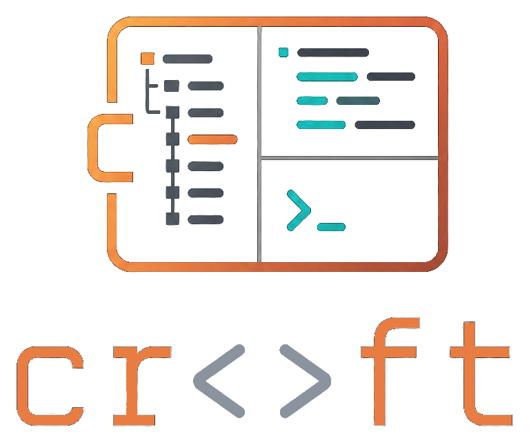

<div align="center">
  
</div>

# croft

A VS Code style three pane workspace that runs entirely inside your terminal. Written in Rust, shipped as a single static binary. The goal is a complete VS Code replacement: everything VS Code does, without leaving the TUI.


## Tenets

The non-negotiables behind every decision in croft:

1. **croft starts in milliseconds. No exceptions.**
2. **Speed is a must.**
3. **Low latency is non-negotiable.**
4. **Local and remote parity always binds.**
5. **The gap between terminal and GUI stays minimal.**
6. **Everything has a shortcut.**
7. **Correctness beats workarounds.**
8. **One binary for the core; extensions arrive in one click.**

See **[TENETS.md](docs/TENETS.md)** for what each one means in practice.

## Layout

An Explorer sidebar, a code editor, and a panel with the terminal, in the VS Code arrangement, with an activity bar that switches the sidebar between Explorer, Search, Source Control, Remote (SSH), Run and Debug, Extensions, and Testing.

* **Editor:** LSP completion, hover, go-to-definition, rename, quick fixes, and inlay hints, with tree-sitter highlighting, multi-cursor, minimap, git gutter, inline blame, and an optional vim mode.
* **Terminal:** shell integration, splits, triggers, copy mode, and durable command history.
* **Source Control:** hunk staging and a commit graph.
* **Run and test:** a Test Explorer, a zero-config task runner, and Live Run, which re-runs a Python file as you type and shows every line's values inline.
* **Debugging:** Python, JavaScript/TypeScript, Rust, C, and C++ over DAP.

See **[LAYOUT.md](docs/LAYOUT.md)** for the pane-by-pane reference.

## Requirements

| Requirement | Why |
|-------------|-----|
| macOS, Linux, or Android (Termux) | The PTY layer is POSIX. On Windows, run the Linux build inside WSL2; see [WINDOWS.md](docs/WINDOWS.md). |
| A Nerd Font as your terminal font | File and activity-bar icons are Nerd Font glyphs; without one they render as `[?]` boxes. |
| A 256 color or truecolor terminal | Terminal.app, iTerm2, Alacritty, kitty, WezTerm, and Ghostty all qualify. |

Building from source needs a Rust toolchain; see [INSTALL.md](docs/INSTALL.md#building-from-source). Optional extras such as inline image and PDF previews are covered in the [platform guides](#platform-setup).

## Install

To build and install croft from the latest source on `main`:

```bash
cargo install --git https://github.com/vitali87/croft.git --locked
```

Prefer a prebuilt binary? Visit **[croft.software](https://croft.software)**.
See **[INSTALL.md](docs/INSTALL.md)** for build prerequisites, other install methods,
upgrading, and verifying release signatures.

## Run

`croft` opens the current directory, and `croft <folder>` any other. `croft remote <host>` runs
it on a Linux server over SSH, installing itself there on first connect, and `croft devcontainer`
runs it inside a folder's dev container.

See **[CLI.md](docs/CLI.md)** for the commands you will reach for most; `croft --help` lists them all.

## Collaboration

`croft attach` keeps a session alive after you close the window, and lets other people join it.
Add `--solo` and each participant gets an independent viewport on the same files, live. An AI can
take a seat too, either as an MCP guest or as a resident pair-programming navigator croft hosts
itself (`croft pair`), local open-weight models included.

See **[COLLABORATION.md](docs/COLLABORATION.md)** for the full guide.

## Platform setup

Each platform has a short guide for its Nerd Font, terminal keybindings, and optional dependencies: **[macOS](docs/MACOS.md)**, **[Linux](docs/LINUX.md)**, **[Android (Termux)](docs/ANDROID.md)**, and **[Windows (WSL2)](docs/WINDOWS.md)**.

## Keybindings

Press `F1` inside croft for the full reference; the complete tables live in **[KEYBINDINGS.md](docs/KEYBINDINGS.md)**. The command modifier is `Cmd` on macOS and `Ctrl` on Linux and Android.

## Contributing

See [ARCHITECTURE.md](docs/ARCHITECTURE.md) for the project layout and internals, and [CONTRIBUTING.md](CONTRIBUTING.md) for the developer workflow.

## License

MIT.
