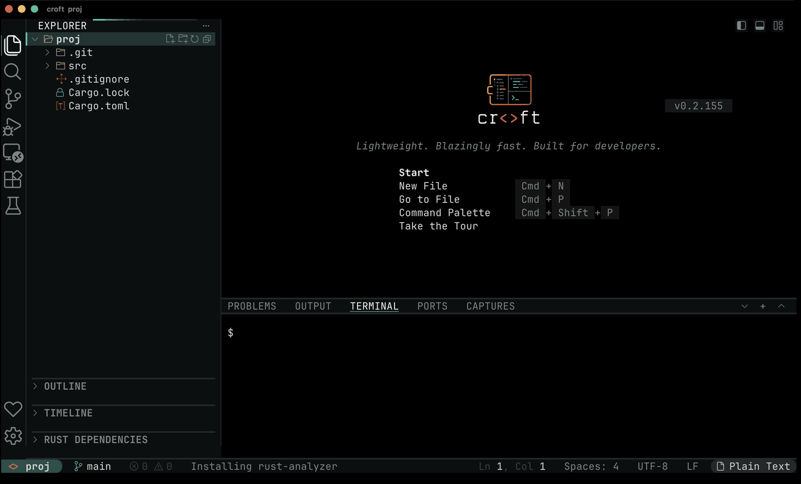
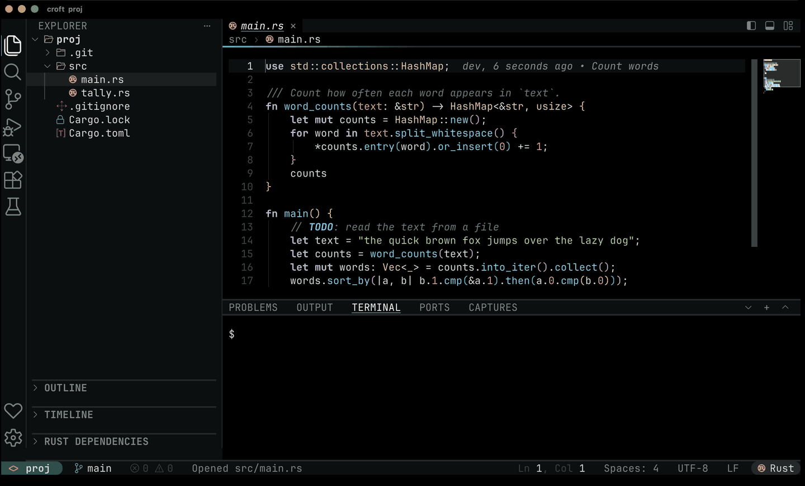
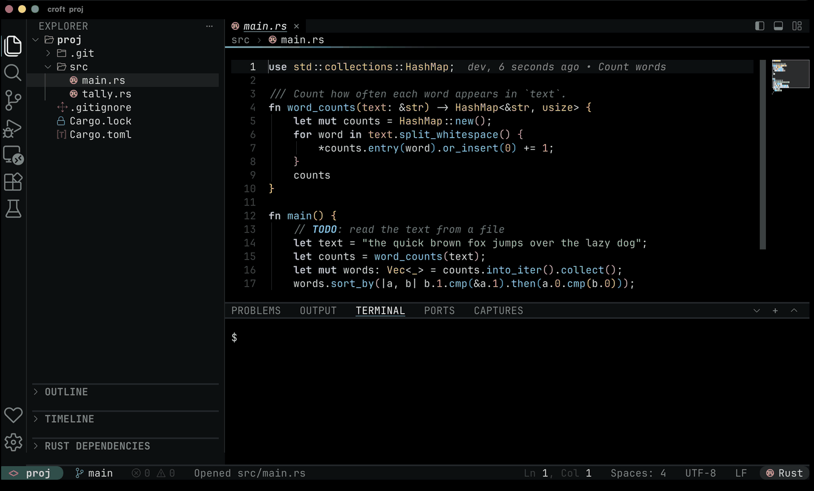
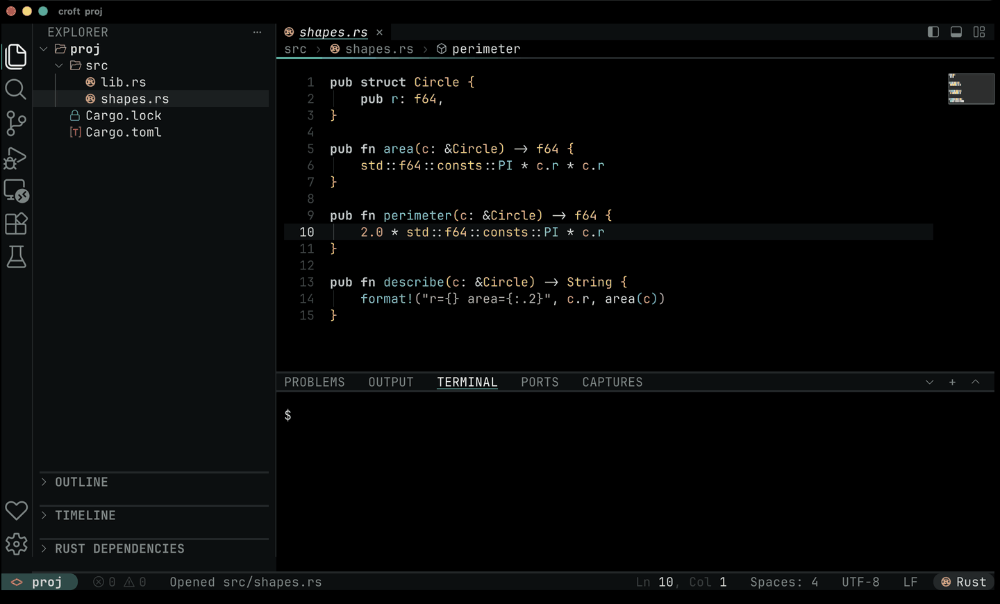
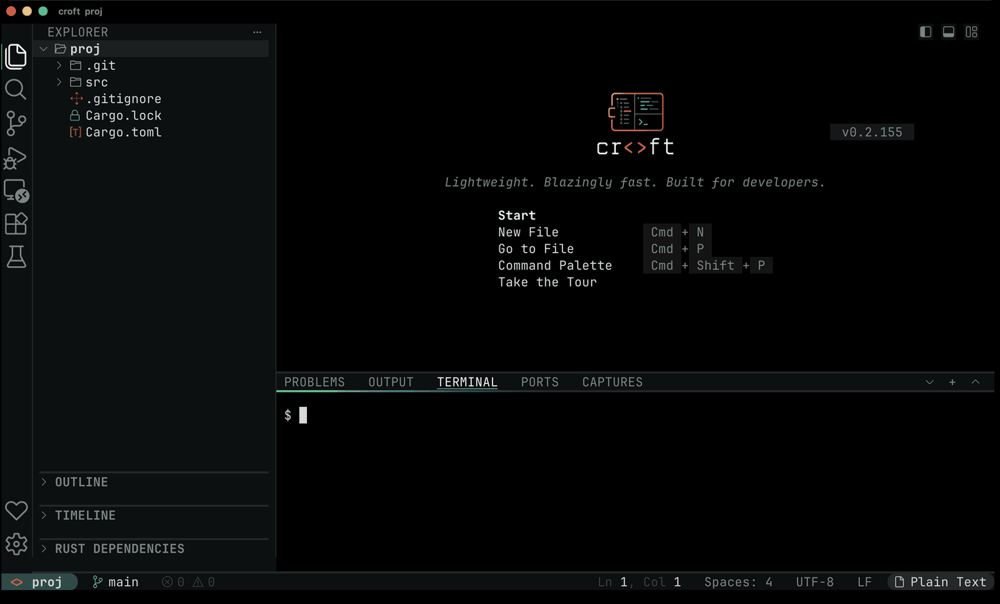
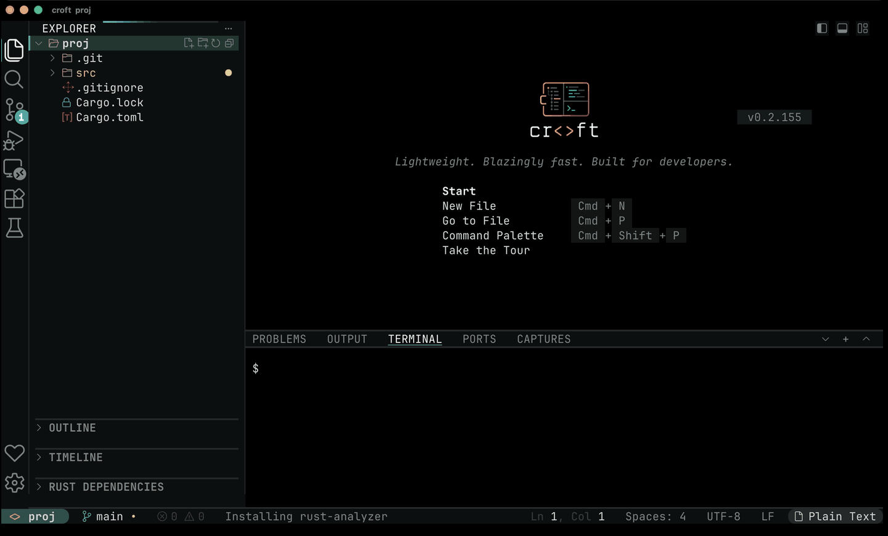
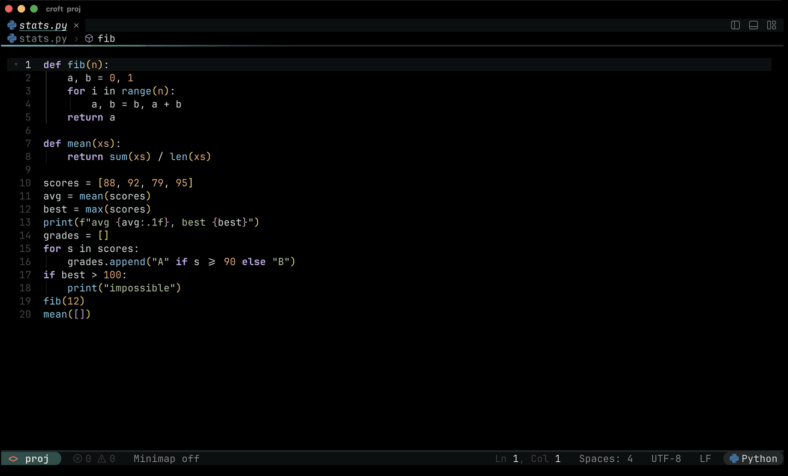

# Layout

croft is a three pane workspace in the VS Code arrangement: an Explorer sidebar, a code editor, and a terminal, with an activity bar down the far left. This is the full pane-by-pane reference; the [README](../README.md#layout) keeps the high-level summary.

## Panes

### Left pane (sidebar)

The Explorer, with VS Code style icons. Search and a Remote (SSH) explorer swap in via the activity bar.

#### Files

* **File operations:** multi-select, cut / copy / paste, and drag-and-drop moves.
* **Rename and move:** croft asks the language servers first, so imports that name the file are updated to match (rust-analyzer, TypeScript and any server that supports `willRenameFiles`).
* **Git-ignored** files and folders show their names in dimmed grey. A fully ignored folder dims along with everything under it.
* The dimming follows `.gitignore` edits.
* **Changed files** show git decorations: the name takes the status colour and its letter sits at the right edge of the row.
* **Status letters:** `M` modified, `U` untracked, `A` added, `R` renamed, `D` deleted, `!` conflicted.
* **A folder with changes inside** takes the strongest of their colours with a `●`, so a collapsed folder shows where your work is.

#### Sub-views

A `⋯` "Views and More Actions" button on the EXPLORER title line toggles which sub-views stack in the panel. The toggles persist across launches. Open Editors is hidden by default, the rest are shown.

* **Open Editors** — the open tabs, with dirty dots and click-to-activate.
* **Folders** — the file tree.
* **Outline** — the active editor's symbol tree (functions, classes, fields), indented by nesting with kind icons.
  * It highlights the symbol the caret is in and jumps the editor to a symbol on click.
  * It paints instantly from tree-sitter on file open, then is refined by the language server's richer symbols when they arrive.
* **Timeline** — the active file's git history (`git log --follow`). Clicking a commit opens its diff for that file.
* **Dependencies** — detects the workspace root's package manifest(s), lists their packages, and labels the header for what it found.
  * A folder with no recognized manifest shows no dependency view and drops it from the ⋯ menu.

| Manifest | Header |
|---|---|
| Cargo.toml | "RUST DEPENDENCIES" (from `cargo metadata`) |
| pyproject.toml / requirements.txt | "PYTHON DEPENDENCIES" |
| package.json | "NODE DEPENDENCIES" |
| go.mod | "GO DEPENDENCIES" |

#### Section sizing

* Each section is individually collapsible.
* Each grows to at most half the region and scrolls independently under the mouse wheel.
* The file tree absorbs the leftover rows.
* OUTLINE and TIMELINE start collapsed to their header chevron until expanded, so they claim no rows from the tree on a fresh launch.

### Search



`Cmd`/`Ctrl`+`Shift`+`F` opens Search in the sidebar: find in files on the ripgrep engine as you type.

* **Toggles:** match case, whole word and regex (`Aa`, `ab`, `.*`).
* **Globs:** "files to include" / "files to exclude" behind the `⋯`.
* **Replace All.**
* **Invalid regex:** a regex that won't compile, such as an unclosed `(` or a look-ahead, shows its error (`Invalid regex: unclosed group`) where the result count would be.
* **Open a hit:** click it to open the file at that line.
* **Dotfiles** and dot-directories such as `.env` and `.github/workflows` are searched unless gitignored. The `.git` store never is.

### Activity bar

The icon strip down the far left.

* **Top:** view icons for Explorer, Search, Source Control, Remote, Run and Debug, Extensions, Testing.
* **Bottom:** a pink sponsor heart above a settings gear.
* **Heart:** opens croft's [GitHub Sponsors page](https://github.com/sponsors/vitali87) in your browser, as does "Help: Sponsor croft" in the Command Palette.
* On a terminal too short for both, the heart gives way first.

#### View icons

* Clicking another view's icon switches the sidebar to that view.
* Clicking the icon of the view already showing collapses the sidebar and hands focus to the editor.
* Click any view icon to expand it again.
* While the sidebar is collapsed no icon shows as selected.

#### Color themes

The gear's Color Theme picker offers:

* **Croft Black** (`#000000`).
* **Croft Loch** (the default): Croft Black's canvas and teal drawn as layered surfaces.
  * No line boxes around panes, and one-eighth-cell seams where regions meet.
  * The brand gradient along the focused pane's top edge.
  * A card-style Command Palette with keycap shortcuts.
  * Every pane and click target exactly where the other themes put it.
* **Croft Dark (Blue)** (`#1e222e`).
* **Croft Light.**
* **Ten editor-inspired dark themes:** One Dark Pro, Dracula, Monokai, Nord, Gruvbox Dark, Tokyo Night, Catppuccin Mocha, Solarized Dark, GitHub Dark, Darcula.
* **High Contrast** and **High Contrast Light**, for low vision: pure black or white behind pure white or black text.
  * Every chrome grey resolves to one of the two, and every other chrome color is lifted to 7:1.

Where the choice and the themes live:

* The choice persists in `~/.config/croft/config.json`, one layer of the settings chain.
* User, machine-local, and per-workspace `.croft/` files merge in order, with `extends` and platform blocks (see [SETTINGS.md](SETTINGS.md)).
* Themes are data: the built-ins ship as a `[[themes]]` manifest, listed in the Extensions panel as "Color Themes".
* Dropping another theme manifest into `~/.config/croft/extensions/` adds it to the picker with no rebuild.

#### Count badges

* **Source Control:** whenever the working tree has changes.
* **Explorer:** unsaved open files.
* **Remote:** ports forwarded home over SSH.
* **Testing:** a red badge for failing tests.

### Top right pane (editor)

* Code editor with tree-sitter syntax highlighting and an LSP semantic-token overlay.
* Inline preview tabs for images, PDFs, and spreadsheets.
* Splits side by side with `Cmd`+`\`.
* An optional native vim modal mode on `Cmd`+`E`.
* The usual VS Code editing commands are built in: move / copy lines, multi-cursor, toggle line and block comments, join lines, sort lines, transform case, trim trailing whitespace, and toggle word wrap.

### Bottom right pane (panel group)

A VS Code-style tab strip over a shared region. The active tab's label is underlined.

#### PROBLEMS

The aggregated workspace diagnostics view. The tab carries an orange count badge of all diagnostics.

* **Groups:** every file with a language-server diagnostic becomes a collapsible group (file icon, name, relative directory, and a count).
* **Rows:** under each group, one row per diagnostic with a severity glyph, the message, and the source server.
* **Click** a file header to collapse / expand it; click a diagnostic to open that file at the line.
* **Toolbar:** filters by severity and toggles grouping by file versus a flat list.
* **Text filter:** with the tab focused, typing filters the list by a case-insensitive substring of the message or the file path.
  * It composes with the severity filter and is shown beside the toolbar's severity chip.
  * `Backspace` pops a character. `Esc` clears the filter before handing focus back to the editor.
* **Hints** stay out of the list and its count, as in VS Code. The editor shows them instead:
  * Code a server marks unnecessary (unused names, unreachable code) is faded.
  * Deprecated code is struck through.
  * A plain hint is marked under its first two characters instead of underlined.
* **Problem matchers:** finished terminal commands feed the same list (see [MATCHERS.md](MATCHERS.md)).
  * Built-ins for rustc, tsc, gcc/clang, Python tracebacks, and eslint need zero configuration.
  * Add your own regexes in `matchers.json`. tasks.json `problemMatcher` declarations are honoured.
  * Watch tasks (`tsc --watch`) republish on every recompile cycle without exiting.

#### OUTPUT

A read-only log viewer, as in VS Code's Output panel.

* **Toolbar:** a channel dropdown, a minimum-level filter, an RPC trace toggle, and a clear action.
* **Body:** the selected channel's level-coloured tail, auto-following new lines until you scroll up.
* **RPC toggle:** traces raw JSON-RPC per server into a `<server> (trace)` channel. Off by default.

Channels appear as producers log:

* One per language server: its `window/logMessage`, `showMessage`, and stderr.
* **Debug Adapter.**
* **Debug Console:** the Run and Debug console's program output and REPL results, at full width.
* **Git:** the exact git commands the Source Control panel runs.
* **Server Provisioning:** managed language-server downloads.
* **Messages:** every status-bar message in full. A click on the message in the status bar opens it here.

A new message too long for the room beside the status bar's Ln/Col and file facts takes the whole bar until the next key or click.

#### Other tabs

* **TERMINAL** — a real interactive shell, your `$SHELL` on a real PTY, splittable into side-by-side panes.
* **CAPTURES** — output lines matched by `capture` triggers (compiler errors, test failures). Clicking an entry jumps its pane back to the line.
* **PORTS** — loopback ports croft detects from terminal output and a periodic socket poll.
  * On a remote session a detected port forwards home over the live SSH connection and opens in your local browser.
  * Cmd/Ctrl+click on a printed `http://localhost:PORT` does the same inline.

#### Keyboard and mouse

* **PROBLEMS or OUTPUT focused:** the arrow / page keys scroll the list. The mouse wheel scrolls it from anywhere.
* **`Esc`** returns focus to the editor. In PROBLEMS the first `Esc` clears the text filter; it returns focus once the filter is empty.
* **`Cmd`/`Ctrl`+`Shift`+`M`** shows PROBLEMS and **`Cmd`/`Ctrl`+`Shift`+`U`** shows OUTPUT, as in VS Code.
* **`Cmd`+`Shift`+`T`** brings TERMINAL forward.
* **Command Palette:** "Terminal: Focus Terminal" and "View: Show Problems / Output / Ports / Captures" reach all five tabs.
* **"Output: Select Channel…"** is the OUTPUT channel dropdown as a keyboard picker.
* Every tab is also reachable by clicking the strip.

### Secondary side bar

An optional auxiliary column on the edge *opposite* the primary side bar, hosting the active file's **Outline**. Toggle it with `Opt`+`Cmd`/`Ctrl`+`B` or from the Customize Layout popup.

All three panes resize by dragging the seams between them, including the seam between the two editor columns when the editor is split.

## Customize Layout



The `⛶` icon at the top-right of the editor (and the welcome screen), or the settings gear → **Customize Layout**, opens a popup of layout controls. Two icons beside it toggle the primary side bar (`▢`) and the panel (`▭`) directly.

The popup groups:

* Visibility toggles: Activity Bar, Primary Side Bar, Secondary Side Bar, Panel, Status Bar.
* **Primary Side Bar Position** — Left/Right; the activity bar moves with it.
* **Panel Alignment** — Left/Center/Right/Justify, where Justify spans the panel across the full content width under the side bar.
* **Quick Input Position** — Top/Center, for the Command Palette / Go to File.
* **Zen Mode** (`Cmd`/`Ctrl`+`K` `Z`) — hides all chrome and restores it on the next toggle, or on `Esc` `Esc` in the editor.
  * It centres the editor too, as VS Code's `zenMode.centerLayout` does. Set `"zen_center_layout": false` under `layout` to keep the full width.
  * For a few seconds after entering it, a box at the bottom says how to leave, since the status bar is hidden.
* **Centered Layout** (also **View: Toggle Centered Layout**) — keeps the editor `centered_layout_width` columns wide (120 by default) in the middle of its column, with plain margins either side.
  * A window no wider than that is unchanged.

Every choice except the frequently-toggled side-bar / panel visibility persists in `~/.config/croft/config.json`.

## Auto-hide side bar

Off by default. When on, moving focus into the editor or a terminal collapses the primary side bar. Focusing back into the sidebar brings it back, as does any reveal (`Cmd`/`Ctrl`+`B`, the activity bar, the Customize Layout row).

### Turning it on

* Use **View: Toggle Auto-Hide Side Bar** in the Command Palette, or the **Auto-Hide Side Bar** row in Customize Layout.
* The choice persists as `sidebar_auto_hide` in `~/.config/croft/config.json`.
* Turning it on while the sidebar is open takes effect at the next focus move, not at once.

### Reveals are pinned

**A reveal you asked for survives the focus move that follows it.**

* `Cmd`/`Ctrl`+`B`, the palette command, the Customize Layout row and the layout-icon click all pin the sidebar open for exactly the next collapse.
* Revealing it and clicking into the editor does not immediately hide it again.
* Focusing the sidebar releases the pin, so the move out after that collapses normally.

### When the collapse is held off

The collapse is also held off whenever something else on screen depends on the sidebar staying put:

* **Focus left less than 400ms ago** - a short grace delay, so a click that passes *through* the panel on its way to the editor does not collapse it under the pointer.
  * The clock starts when focus first leaves and is not restarted while it stays away, so the collapse cannot be pushed back indefinitely.
  * Returning focus to the sidebar cancels it.
* **A drag** - either the sidebar seam or an Explorer drag.
* **Anything modal** - several of these target the sidebar, and some may be anchored over sidebar space:
  * The keyboard-shortcuts overlay (`F1`), the Command Palette, Go to File, Go to Symbol, workspace symbols.
  * The process picker, `Cmd`+`Z` directory jump, command history, the branch picker.
  * An input prompt, a list picker, a context menu, or the SSH connect dialog.
* **A focus move you did not make** - an async result arriving, a file opened at launch, `Enter` on a sidebar row. Only a deliberate move into the editor or terminal collapses the panel.
* **A hidden activity bar** - with no activity bar there is no on-screen way back to a collapsed sidebar, so a mouse-only user would be stranded.
* **Zen Mode** - it already owns chrome visibility and keeps it.

## Command Palette



* **Command Palette:** `Cmd`/`Ctrl`+`Shift`+`P` fuzzy-searches and runs every named command.
* **Go to Symbol:** `Cmd`/`Ctrl`+`Shift`+`O` fuzzy-jumps within a file, or to a line with a `:` prefix.
* **Workspace symbols:** a `#` prefix in Quick Open searches symbols across the whole workspace through the language servers.

## Editor

### Viewing and navigating

* Tree-sitter highlighting, side-by-side splits, and bracket-match highlighting.
* **Inline previews** for images / PDFs / spreadsheets.
* **Rendered views** (Markdown / notebook / document) are selectable: drag to select the text you can see.
  * `Cmd`/`Ctrl`+`C` copies the rendered text rather than the source. `Esc` clears.
* **Breadcrumbs bar:** the file path plus the enclosing symbol trail at the caret. Click to jump.
* **Sticky scroll:** the enclosing scope headers pinned to the top while you scroll.
* **Document links:** Ctrl+click a URL, import specifier, or path the server marked as a link and croft follows it.
  * Files open in the editor, web targets go to the system opener, other schemes are refused.

### Minimap

A file preview in a right-edge strip beside the active editor group.

* Click or drag to jump.
* Right-click to toggle or re-side it.
* Terminals with inline images (Kitty, iTerm2, WezTerm, sixel) get a rasterized preview.
* Everywhere else (tmux, Alacritty, GNOME Terminal, plain xterm) it is drawn in braille dots.
* It needs an editor at least 50 columns wide.

### Symbol tabs

`Cmd`+`K` `Shift`+`V` opens the function or class at the caret as its own tab.

* The tab shows only that symbol.
* Edits land in the file.
* It follows the symbol as the file changes.



### Code folding

* **Ranges:** the language server's fold ranges when it provides them, with an indentation + `#region`-marker + comment-run fallback.
* **Collapse** from a gutter chevron or `Cmd`/`Ctrl`+`K` chords, including Fold All Block Comments and Fold/Unfold All Regions.

### Editing

* **Multi-cursor:** `Cmd`/`Ctrl`+`D` for the next match, `Option`+click for a caret, `Shift`+`Option`+drag for a column selection.
* **Expand/shrink selection** (`Shift`+`Alt`+`→`/`←`): LSP selection ranges with a tree-sitter ancestry fallback.
* **Find and replace in file:** `Cmd`/`Ctrl`+`F` to find, `Cmd`+`Opt`+`F` / `Ctrl`+`Alt`+`F` to replace, with regex capture references.
* **Undo and redo** (`Cmd`/`Ctrl`+`Z` and `Shift`+`Cmd`/`Ctrl`+`Z`): typing bursts coalesce into one step, and a fresh edit after an undo discards the redo branch.
* **Format on save:** toggled with `Cmd`/`Ctrl`+`K` `F`.
* **Format on type:** runs on the server's trigger characters. Off by default; toggle in Settings or the palette.
* **Keyboard macros:** vim `q`/`@` registers plus palette commands.
  * A red `● REC` badge shows in the status bar while recording.
  * Registers persist to `macros.json`.
* **Mouse gestures:** `keybindings.json` binds ctrl/alt/shift-modified clicks, middle click, right click and the wheel per region.
  * Refused rows report in OUTPUT.
* **Vim mode:** optional.

### Auto save

Two modes, as in VS Code. Each has its own toggle in Settings and the Command Palette, so either or both can be on.

* **afterDelay:** dirty buffers write themselves a second after the last edit.
* **onFocusChange:** a buffer writes itself the moment it loses focus, when the editor pane hands focus away or the active tab changes.
  * Every dirty buffer also writes itself when the terminal window croft runs in loses focus (VS Code's onWindowChange).
  * That relies on the terminal's focus events; inside tmux it needs `set -g focus-events on`.

### Unsaved changes

Unsaved changes are never dropped without asking.

* **Quitting** (`Ctrl`+`Q`) with an unsaved tab in any split raises a prompt.
* **Closing an unsaved tab** (`Cmd`/`Ctrl`+`W`, its `✕`, View: Close Editor) raises the same prompt.
* **Prompt choices:** save (everything, for a quit), go on without saving, or cancel.
* **A save that cannot land** (an untitled buffer, a file changed on disk) keeps croft or the tab open and says which file.
* **Close All, Close Others and Close to the Right** leave unsaved tabs open and say how many they kept.
* **Connecting to a remote workspace** ends this croft once the remote one is up, so it asks the same way when asked for.
  * It asks again at that handoff about anything edited while the remote side was being prepared.

### Hot exit

While anything is unsaved, croft backs up the workspace's unsaved buffers.

What is backed up, and where:

* **Contents:** each unsaved buffer's path, text and cursor, untitled ones included.
* **Location:** `~/.local/state/croft/hot-exit/<workspace digest>/` (`$XDG_STATE_HOME/croft` when set).
  * It is not the cache directory, which cleaners delete. A backup an older croft left under `~/.cache/croft` moves there at launch.
* **Timing:** five seconds after the last edit, and only when the buffers changed.
* **A failed write** is reported and retried every five seconds. Until one lands, a crash leaves the last backup written.
* **A tab closed without saving** is taken out of the backup at once.
* **A clean quit**, or answering the quit prompt with save or discard, removes the backup.
* Only regular files in the backup directory are read or removed, never through a symbolic link.

Restoring:

* A kill or crash (an OOM kill, a closed terminal) leaves the backup.
* The next launch of the workspace restores each buffer as an unsaved tab without writing its file.
* Auto save, when on, then treats it as any other unsaved edit.
* **A file changed on disk since** is named in the status line, and its first save asks before overwriting that change.
* **A deleted file** comes back as a tab for its path. Its first save asks too, so a file made there since is not written over.
* "Changed on disk" compares modification time and size, so a rewrite that keeps both goes unnoticed.

Several windows:

* Each croft window keeps its own backup, named for its pid and when the process started.
* A second window on the workspace neither restores nor removes the first one's.
* A dead croft's backup is still restored after its pid goes to another process. A backup named by its pid alone is judged by the pid.
* Where two dead windows' backups hold the same file, the newer copy is restored.
  * The older one stays in its backup, named in the status line, for a launch after the newer copy is saved or closed.

Backups that cannot be read or removed:

* A backup that cannot be read is reported and kept for a week, then removed.
* A backup a quit cannot remove has its text cleared first where it can be, and is reported, on stderr too.
* The same goes for a backup restored from that cannot be removed once the new one lands. The quit then tries again.

### Git in the editor

* **Git gutter:** thin coloured bars marking lines added, modified, or deleted against HEAD.
* **Inline blame:** a dim annotation trailing the cursor's line with the author, age, and commit summary. Toggle from the Command Palette.
* **Merge conflicts:** conflict blocks tint green / blue, and `Cmd`/`Ctrl`+`.` offers Accept Current / Incoming / Both.

### Language server features

Completion, signature help / parameter hints, hover, go-to-definition, rename, formatting (whole document and Format Selection), quick fixes / code actions, and diagnostics, plus:

* **Rename:** the server validates the position first and its placeholder is pre-filled.
  * A server that has not answered within two seconds gets the word-under-cursor prompt instead.
* **Linked editing:** editing one HTML/JSX tag renames its pair live.
* **Color swatches:** a `■` in the value's color before `#rrggbb`/`rgb()` literals, with a "Change Color Presentation" picker to rewrite the spelling.
* **Inlay hints:** inferred types and parameter names inline as dim italic annotations. On by default; toggle with **Editor: Toggle Inlay Hints**.

### Markdown

* **Source colouring** uses the theme's own roles: headings, list and task markers, quotes, bold / italic / strikethrough, inline code, links, and table headers.
  * Fenced code blocks and front matter take their own language's colours.
* **Rendered preview** on `Cmd`/`Ctrl`+`Shift`+`V`: headings, emphasis, lists, task checkboxes, quotes, aligned tables, links, and fenced code blocks.
  * Code blocks are coloured by the editor's own tree-sitter highlighters.
  * The preview reflows with the pane and follows your edits.

### Customizing

All of these live under `~/.config/croft/` and are reachable from the Command Palette:

* **Keys:** rebind any command in `keybindings.json`.
* **Snippets:** define `Tab`-expandable snippets, with tab stops and placeholders, in `snippets.json`.
* **Settings:** flip settings from a searchable **Preferences: Open Settings** hub.

## Terminal



The TERMINAL tab is your `$SHELL` on a real PTY, splittable into side-by-side panes.

### Shell integration

Shell integration auto-installs for zsh, bash 4.4+, and fish.

* **Prompt jumps:** `Cmd`/`Ctrl`+`Opt`+`Up`/`Down` jumps between command prompts.
* **Gutter dots:** every finished command gets a dot on the pane border, blue for success, red for failure.
  * Click it for the exit code, runtime, and a menu to copy or select that command's output or re-run it.
* Long commands finishing in an unfocused pane announce themselves.
* New splits inherit the shell's exact cwd.
* Notifications a program sends through the terminal surface in the status bar.

### Find, select and copy

* **Find:** `Cmd`/`Ctrl`+`F` searches the pane's screen and scrollback with every hit highlighted.
* **Quick select:** `Ctrl+Shift+Space` labels every URL, path, hash, and IP on screen so two keystrokes copy one. UPPERCASE pastes it into the shell.
* **Copy mode:** `Ctrl+Shift+Y` enters copy mode, where vi keys walk the scrollback.
  * `v`/`V`/`Ctrl+V` select by character, line, or rectangular block before `y` copies.
* **Selections** stay glued to their text through streaming output, through your scrolling, and inside full-screen apps that scroll by repainting (Claude Code, pagers).
  * There the highlight follows the app's own scrolling and keeps its surviving rows lit while the app's chrome covers the block's edge.
  * It hides only when the text is fully off the app's view, and comes back with it. Copy still yields the whole selection.
* **Extend:** `Shift`+click extends a selection.
* **Drag past the edge:** a drag held past the pane edge keeps selecting, through scrollback at a shell, or by scrolling the app itself when it owns the wheel.

### Command history and suggestions

* **Command history:** `Ctrl+Shift+H` searches every command run under croft, kept across restarts with its directory, exit code, and duration.
  * Filter to the current directory or failures only. `Enter` types the pick back at your prompt.
* **Command suggestions:** as you type at a prompt, the rest of the newest matching command from croft's history appears after the cursor in grey.
  * It prefers one that succeeded in the same folder.
  * `Right` at the end of the line accepts it, as in fish.
  * A shell that draws its own suggestions (fish, zsh-autosuggestions) is left alone.
  * **Terminal: Toggle Command Suggestions** turns croft's off.

### Triggers and captures

* **Triggers** from `triggers.json` watch the output stream. They highlight matches in your colours, post status-bar notices, or capture matching lines into the CAPTURES tab.
* In CAPTURES, one click jumps back to the line.
* **Ask about a capture:** in CAPTURES, `n` on a row asks the resident Navigator about that line with the pane rows around it.

### Agent lanes

A pane whose foreground process is a coding agent (claude, codex, aider, gemini, crush, or a row from `agents.json`) wears `◆ claude` in its name pill with a status glyph.

* **Glyphs:** `●` working, `◐` waiting for you, `○` idle.
* **Self-reported status:** an agent that reports its own status (Claude Code 2.1.295+, Crush 0.98+) is taken at its word, so a permission prompt or a finished turn shows the moment it happens.
* Other agents are read off the screen.
* **Status bar:** shows `◆ 2 agents · 1 waiting` while any is seated. Clicking it reveals the waiting pane.
* **Explorer:** a worktree lane's root row wears the lane's branch and that same badge after the folder name (`repo-fix-login  agent/fix-login · ◆ claude ●`).
  * It shows the configured agent's bare name before it is seated, or the branch alone for a plain-shell lane.
* **"Agents: Show Changed Files"** groups the review queue by root, so a lane's changes read as their own section named by its branch.

### Broadcast, images and progress

* **Broadcast:** `Cmd`/`Ctrl`+`K` `I` broadcasts your typing to every pane at once for multi-server work.
  * It sits behind a confirm popup, and red `⇶` pills mark the receiving panes.
* **Inline images:** `imgcat` pictures render inline at their output row.
* **Progress:** a program reporting OSC `9;4` progress (systemd, winget, cargo wrappers) turns the pane's bottom border into a live gauge.
  * Blue advancing, red frozen on error, yellow paused, a sweeping segment while indeterminate.
  * The percent is echoed in the pane's name pill.

### Scrollback

* `Shift+PageUp`/`PageDown` page the scrollback. Its depth is configurable.
* Scrolling deep into output pins the producing command to the pane's top row.
* A palette toggle shows each row's arrival time down the right edge.
* Clicking the prompt line moves the shell cursor there.
* `Cmd`/`Ctrl`+`K` `D` opens the pane's whole scrollback in an editor tab.
* `Cmd`/`Ctrl`+`K` `N` pins a note to selected output (amber-underlined, click to read).

### Pane management

* **Colors:** pane colors follow the theme's own ANSI palette, so output looks identical in every host terminal.
* **Reorder:** drag a pane's name pill to reorder panes.
* **Maximize:** the `⛶` button at the right end of the panel's tab row or `Cmd`/`Ctrl`+`K` `M` maximizes one pane across the panel.
  * The rest wait in a right-edge rail you can shuffle through or drag into a new order.
* **Undo close:** a closed pane stays undoable for 10s. `Cmd`/`Ctrl`+`K` `Shift+T` brings it back, process intact.
* **Saved layout:** the whole pane layout (directories, names, focus) is saved per workspace and restored on the next launch.
* **Host accents:** `host_accents` rules in config.json dress panes on matching hosts. Production shells get a red border, warning pill, and badge watermark.

### Jump to source

* Cmd/Ctrl+click on any printed `path:line` reference (a compiler error, test failure, grep hit, or traceback) jumps the editor straight there, with no problem-matcher config.
* **Terminal: Search & Replace from Last grep/rg** in the Command Palette turns the `grep`/`rg` you just ran in a pane into the Search sidebar's results, ready to replace across every match.

## Source Control



Source Control follows VS Code's git flow.

* Stage, unstage, and discard per file or in bulk.
* Commit / amend / push / pull / sync.
* Branches, stashes, and tags.
* Clicking a change row opens a side-by-side diff against HEAD.

### Staging hunks and lines

Inside that diff, single keys act on the change hunk under the cursor.

* `S` stages just that hunk.
* `U` unstages it.
* `R` reverts it after a confirm.
* Drag a selection across rows first and `S`/`U` narrow to exactly those lines, leaving the rest of the hunk untouched in the index.

### Operations in progress

When a merge, rebase, cherry-pick or revert stops on a conflict, or a bisect is running, the status bar names it next to the branch, and so does the Source Control header.

* **Labels:** `main | MERGING`, `REBASING 2/5`, `CHERRY-PICKING`, `REVERTING`, `BISECTING`.
* **During a rebase** the name shown is the branch being rewritten (`feature | REBASING 1/1`), though git has HEAD detached on the commit it replays onto.
* **The ⋯ menu** then starts with that operation's way forward and way out:
  * **Continue Rebase / Cherry-Pick / Revert** — resolve and stage the conflicts first; each commit keeps its message.
  * **Skip Commit**.
  * **Abort Merge / Rebase / Cherry-Pick / Revert**.
  * A bisect gets **Mark Good**, **Mark Bad** and **Reset**.
* **Palette:** **Git: Continue ...**, **Git: Skip Commit ...** and **Git: Abort ...**.
* A merge is concluded by committing.
* Committing from Source Control in the middle of a rebase continues the rebase too, so it never stops on a detached HEAD.

### Commit graph

Below the change list, a **COMMITS** section draws the repo-wide commit graph.

* Colour-cycled box-drawing rails trace every branch and merge across local branches and tags.
* Each row shows its ref badges (HEAD's branch bold, tags gold), subject, and age.
* Clicking a commit opens its full patch (header, message, diffstat, diff) in a read-only editor tab.
* The graph refreshes itself whenever HEAD moves.

## Pull request review

`croft pr 123` (or a PR URL), or **Source Control: Review Pull Request** with a picker over the open PRs, opens a **PULL REQUEST** tab.

* It lists every changed file with `+n −m`, then the checks.
* A summary heads the list: `3 of 12 viewed · 10 passed · 1 failed`.

| Key | Action |
|---|---|
| `Space` | Marks a file viewed. The mark persists. |
| `Enter` | Opens a file's diff, or a check's log. |
| `l` | Opens the failing check's log. |
| `r` | Refreshes. Pending checks also refresh on their own. |
| `c` | Checks the PR's head out into a worktree. |
| `Esc` | Leaves review and removes the checkout. |

### Checkout

* `c` puts the worktree beside the repository (`<repo>-pr-123`) and adds it to the workspace, so the changed code has the language server, go-to-definition and tests.
* Pressing `c` again after a new push moves the checkout.
* A checkout with edits, build output or new commits in it is kept on `Esc`, and the status says why.

### Comments and reviews

* **Review: Load PR Comments for This File** shows the branch's PR threads as boxes under their lines, with replies folded into their thread.
* Type a reply into a box's field and it posts to GitHub.
* **Review: Resolve or Unresolve Thread** acts on the focused box, or the next one.
* **Review: Add Comment on This Line** adds a pending comment, shown as a box.
* **Review: Submit Review** sends the pending comments as Comment, Approve or Request Changes with a summary.
* Comments on lines outside the diff go into the summary.
* **Review: Discard Pending Comments** drops them.

### Exporting navigator notes

* **Source Control: Export Comments to Pull Request** posts the navigator's notes, together with your pending comments, as one review on the branch's PR.
* It shows a preview first, listing each comment and how many go inline versus into the summary.
* The navigator's comments start with `[AI, croft navigator] `. Set `review_ai_prefix` to change it, or `""` to drop it.
* Once posted, they leave the editor and come back as the PR's threads.

## Interactive rebase

`git rebase -i` run in a croft terminal opens its plan (`git-rebase-todo`) as a croft tab.

* **How:** croft points `GIT_SEQUENCE_EDITOR` at `croft edit --wait` in every pane it spawns. A sequence editor you set yourself always wins.
* **Actions:** a single key sets the caret commit's action. With vim mode on, those keys stay vim's.
* **Reorder:** `Alt`+`Up` / `Down` reorder commits.
* **Finish:** save and close the tab and git carries on.
* **Abort:** **Rebase: Abort** in the palette empties the plan, which makes git abort.
* **A shell that outlives its croft**, such as a tmux server started from a croft pane, keeps that setting.
  * Once the croft is gone, `git rebase -i` there opens the plan in git's own editor instead of failing.

| Key | Action |
|---|---|
| `p` | pick |
| `r` | reword |
| `e` | edit |
| `s` | squash |
| `f` | fixup |
| `d` | drop |

`croft edit --wait <file>` works for any tool that wants an editor it can wait on. That includes one that names a file it has not written yet: croft creates it empty and opens it, provided its folder exists.

## Local history

* croft snapshots each file as you save it.
* The Explorer's TIMELINE lists those snapshots next to the git commits.
* Diff any past version against the working file or restore it, including versions you never committed.

## Testing

A **Testing** view (the beaker icon, or `Cmd`/`Ctrl`+`K` `B`) discovers the project's tests on first open and lists them as a suite tree with live pass/fail/skip glyphs, as in VS Code's Test Explorer.

### Runners

* **Rust:** `cargo test`.
* **Python:** `pytest`.
* **JS/TS:** `vitest` or `jest`, detected from package.json.
* **Go:** `go test` for a Go module or a `go.work` workspace.
* Each runner is a built-in extension, so switching one off in the Extensions panel stops its projects being detected.

How pytest is launched, in order:

* As `python -m pytest` under the project's `.venv` (or `venv`) when pytest is installed there, so tests can import the project's own modules.
* Without one, as `python3 -m pytest` when that `python3` can import pytest.
* Only then as a `pytest` script found on `PATH`.

### Running tests

* **Row play glyph:** runs that test or suite.
* **Gutter:** a green ▷ marks test functions in the editor gutter. Click it to run.
* **Test name:** clicking it jumps to its source.
* **Enter** runs everything.
* **`Cmd`/`Ctrl`+`K` `Enter`** runs the test under the editor caret.
* A test started from the caret or a gutter ▷ replaces its "Running test …" status with how it went once it ends: `test_total passed (0.4 s)`, or "Run failed" pointing at OUTPUT.
* The beaker icon wears a red badge counting failures.

### Failed discovery or run

When discovery or a run fails with no failing test to show for it (a collection error, a build failure, a runner that isn't installed):

* The summary says **Discovery failed** or **Run failed** and points at the reason.
* Click "see OUTPUT › Test Runner", or press `o`, to open OUTPUT on the Test Runner channel, where the runner's traceback or compile error is.

### Coverage

Starting a coverage run:

* "Testing: Run All Tests with Coverage", or the bar-chart glyph in the TESTING header, runs everything.
* The same glyph on a suite or test row, just left of its eye, runs only that suite or test.

Tools:

* pytest-cov, `@vitest/coverage-v8`, jest's built-in coverage, `cargo llvm-cov` for Rust, or `go test -coverprofile` for Go.
* Each writes LCOV (croft converts Go's profile), which croft reads into one model.
* If the tool isn't installed, croft says which one. "Testing: Install Coverage Tool" runs the install in a terminal pane.
* The install is `cargo install cargo-llvm-cov`, `uv add --dev pytest-cov` (or pip), or the project's npm/pnpm/yarn for vitest.

Reading the result:

* **Suite rows:** once a report covers a suite's own file, the row shows that file's line percentage before the glyph.
  * For a pytest or JS suite that is the file itself.
  * For a cargo suite it is the module's file: `parse::tests` is `src/parse.rs`, or `src/parse/mod.rs`.
* **Editor:** the change-bar lane shows each executable line of a covered file. Green ran, red never ran, and a short amber mark means the line ran but one of its branches never did.
* **Stale marks:** once the file is edited or rewritten after the run, the marks dim.
* **Status bar:** the Ln/Col readout adds the file's line percentage.
* **"Coverage: Clear"** drops the report and gives the lane back to git.

### Stopping a run

While a run or discovery is in flight the summary line shows a ■ Stop control.

* Clicking it, `s` in the view, or "Testing: Cancel Test Run" kills the runner's whole process group (pytest-xdist workers and `cargo test` binaries included).
* It marks the tests that never reported as not run, and says "Test run cancelled".
* A run still going when croft quits is stopped the same way.
* Starting another run while one is in flight says so instead of doing nothing.

### Watch mode

Each row ends in an eye: click it to watch that test or suite.

* The eye in the TESTING header (or `w`, or "Testing: Toggle Watch All Tests") watches everything.
* While a watch is on, saving any file under the runner's root reruns the watched scope about 300 ms later.
* A file git ignores (build output, a `.env`) does not trigger a rerun.
* A burst of saves reruns once, and a save made while another run is going waits for it.
* A rerun leaves the sidebar where it is.
* A watched run that turns red (from green or from never having run) raises the beaker's badge and names the failing test in the status line.
* "Testing: Go to First Failure" jumps to its source.
* A run that stays red or goes green says nothing.
* One scope is watched at a time: clicking another eye moves the watch, and clicking the lit one turns it off.

## Live Run



`Cmd`/`Ctrl`+`K` `V` (or **Python: Toggle Live Run** in the palette) turns a Python file into a live notebook without cells. Every time you pause typing, croft runs the buffer, unsaved edits included, and paints what each line did beside it:

```text
def fib(n):  n = 10
    for i in range(n):  i = 0, 1, 2 … 9 ×10
        a, b = b, a + b  a = 1, 1, 2 … 55 ×10  b = 1, 2, 3 … 89 ×10
    return a  ↩ 55
squares.append(k * k)  squares = [0], [0, 1], [0, 1, 4] … [0, 1, 4, 9, 16] ×5
print("total is", total)  ▸ total is 30
fib(10)  → 55
ratio = total / (len(squares) - 5)  ✖ ZeroDivisionError: division by zero
```

* **Values**: what each assignment, loop variable, parameter, and in-place method call (`items.append(x)`) left behind.
  * A line that runs many times shows the first values it took, then the last, then how many times it ran.
  * Objects without their own `__repr__` show their fields (`Point(x=3, y=4)`).
* **Output and results**: what a line printed (`▸`), what a `return` returned (`↩`), and the value of a bare expression (`→`), so a trailing `fib(10)` works like a REPL.
* **Failures**: the exception lands on the line that raised it, in red.
  * A run that goes past 3 seconds is interrupted and the line it was stuck on says so, in amber.
* **Coverage**: line numbers go green for statements that ran and a muted red for statements that never did.

### How the run executes

* **Working directory:** the file's own directory, which is also `sys.path[0]`.
* **Interpreter:** the nearest `.venv` / `venv` / `.env` interpreter inside the workspace, falling back to `python3`.
* Imports and relative paths behave as they would from a terminal.
* stdin is empty and nothing is written to `__pycache__`.
* **Stale lines:** only a line whose text still matches the run shows a value, so an edited line goes bare until the next run lands.
* **Debugger:** a stopped debugger's inline values take precedence over Live Run's on the same line.
* **Armed per file:** Live Run executes your code on every pause, so toggling it on for one script never runs another, and nothing runs until you ask.

## Tasks

Zero configuration: `Cmd`/`Ctrl`+`Shift`+`B` runs the project's build task, auto-detected from the manifests the repo already has.

* Makefile.
* justfile.
* package.json, with the right lockfile runner.
  * In an npm, pnpm or yarn workspaces monorepo, every package's scripts too, run from that package.
* Cargo.toml.
* pyproject.toml.
* go.mod.
* CMakeLists.txt with its presets.
* `.vscode/tasks.json` when present.

Running tasks:

* "Tasks: Run Task" in the palette lists everything discovered.
* Each task runs in its own named terminal pane, and rerunning reuses that pane.

## Status bar

* **Left:** branch and ahead/behind, error/warning counts (click to open Problems) and the active language server.
* **Right:** cursor position, indentation, encoding, line ending, and language mode.

Click a segment to change it:

* **Indentation** opens the Select Indentation menu: Indent Using Spaces / Tabs, change the tab size, or convert the buffer's existing indentation.
* **Encoding** reopens the file with a different encoding.
* **Line ending** switches LF/CRLF.
* **Language mode** overrides the language mode.

## Screencast Mode

For recording a demo, a talk or a pull request GIF. `Shift+F8` (or the palette's **Developer: Toggle Screencast Mode**, as in VS Code) shows every key you press as a key cap in a box at the bottom of the screen, gone a moment after the last one.

* **Commands:** a palette pick or a `keybindings.json` chord is named beside its key (`Enter  View: Toggle Zen Mode`), so a viewer sees what ran after the palette has closed.
* **Clicks:** a click lights the cell it landed on, since a terminal recording has no mouse pointer.
* **Typing** gathers into one run.
* **A held key** is counted (`↓ ×12`).
* **A `Cmd+K` chord** reads as one (`Ctrl+K Z`).
* **A modified click** shows as a key (`Ctrl+Click`).
* **A paste** from the terminal shows as `Paste`, never its text.
* **Passwords and the shell:** what you type into a password field or the shell is never shown (sudo reads a password with echo off), only the keys around it.
* The box moves to the top of the screen while it would cover the caret.

## Debugging

### Python with breakpoints

Set breakpoints in the editor gutter (`F9`) and press `F5`. croft launches the file under debugpy so it stops on the red lines.

| Key | Action |
|---|---|
| `F9` | Set a breakpoint |
| `F5` | Start, or resume |
| `F10` | Step over |
| `F11` | Step into |
| `Shift+F11` | Step out |
| `F6` | Pause a running program |
| `Shift+F5` | Stop |

When paused:

* The Run and Debug panel shows the call stack and an expandable variables tree.
* A debug console shows program output, with a `❯` REPL that evaluates in the selected frame.
  * Long lines wrap to the panel. OUTPUT's **Debug Console** channel holds the same text at full width.
* Hovering a variable in the editor shows its value.
* A stop on an exception names its type and message in the panel and the status line.

Breakpoints:

* Conditional breakpoints (a red `◆`) and break-on-exceptions are in the Command Palette.
* Breakpoints the adapter can't bind show hollow (`○`).

Interpreter:

* The program runs under the project's own interpreter, the one Run uses, so its installed packages import.
* That is the nearest `.venv` / `venv` / `.env` in the workspace, else `python3`.
* croft provisions a private CPython 3.14+ debugpy venv on first use to host the adapter only.

### Other languages

* **Rust / C / C++** files route to `lldb-dap`.
* **Go** files route to delve (`dlv`).
* Without delve, "Debug: Install Go Debugger (delve)" runs `go install` in a terminal pane, into `~/.croft/servers/go`, and says so if Go itself is missing.
* It installs a delve that works with your Go: delve 1.25.2 for Go 1.24 and older (newer delve refuses them), the latest otherwise.
* If the debugger refuses to start the program anyway, the session ends with its reason in the status line and the debug console.

### More breakpoint kinds

* **"Debug: Add Hit Count Breakpoint"** pauses only once a line has been hit N times.
* **"Debug: Add Function Breakpoint"** pauses on entry to a named function. It is kept for every later session too.
* **"Debug: Break When Value Changes"** pauses when a variable of the paused frame is written (adapters with data breakpoints, such as lldb-dap).
* **`Ctrl+F10`** runs to the caret line and stops there once without leaving a breakpoint behind.
* Kinds an adapter does not support say so instead of silently doing nothing.

### Debug configurations

croft reads `launch.json` debug configurations from `.vscode/launch.json` (JSONC, unchanged from VS Code) and `.croft/launch.json` (same schema, no `.vscode/` required).

Supported fields:

* Program arguments, `env`/`envFile`, `cwd`, `stopOnEntry`.
* A `preLaunchTask` resolved against the task registry. It runs in its terminal pane and gates the launch on exit 0.
* Attach by `port` (node, python) or `processId` (lldb).
* `${...}` variable substitution, with loud errors for unresolvable variables.
* Adapter-specific fields are passed through verbatim.

Choosing and adding:

* "Debug: Select and Start Debugging" (or the config row in the Run and Debug panel) picks what `F5` launches.
* The zero-config "Debug active file" entry is always there.
* "Debug: Add Configuration…" builds a new entry one prompt per field and adds it to `.croft/launch.json`.

### Compounds

Compounds declared in the same file are listed too, with their member configurations.

* Selecting one that names a SINGLE configuration launches it.
* One that names several is refused rather than launched as a subset. Running several sessions at once is [still to build](https://github.com/vitali87/croft/issues/310).
* `presentation.hidden` keeps a compound out of that picker entirely, and one asking only to be hidden launches normally.
* `presentation.group` and `presentation.order` want an ordering the picker does not have, so a single-member compound setting either is refused rather than launched without it ([#318](https://github.com/vitali87/croft/issues/318)).
* A compound's own `preLaunchTask` runs before its member starts and gates the launch on exit 0, as a configuration's own task does.
* It chains with the member's task if it has one.

### Attach to a running Python process

* "Debug: Attach to Python Process" in the Command Palette lists live CPython 3.14+ processes.
* It drops a `pdb` REPL into the one you pick, with no restart and no instrumentation.
* The debugger and any `sudo` password prompt run right in a terminal pane.

## Language servers

The editor speaks LSP. Each server is anchored at the file's own project root, so monorepo sub-projects resolve correctly.

* Completion, hover, and diagnostics.
* Go-to-definition / references / implementations.
* Rename.
* Document formatting (`Cmd`+`Opt`+`Shift`+`F`).
* Quick fixes / code actions (`Cmd`+`.`): auto-import, fix-all, organize imports, and refactors.
  * They are picked from a menu and applied as one undo step. Servers that defer the edit are supported.

Which server runs per language:

| Language | Server |
|---|---|
| Python | Astral's `ty` as the primary, `basedpyright` as a fallback for the few capabilities `ty` does not yet advertise, and `ruff` for lint |
| TypeScript / JavaScript | `vtsls` |
| YAML | `yaml-language-server` |
| JSON / HTML / CSS, SCSS, Less | the VS Code servers: `vscode-json-language-server`, `vscode-html-language-server`, `vscode-css-language-server`, which also serves `.scss` and `.less`; `.sass` is highlighted only |
| Bash | `bash-language-server` |
| TOML | `taplo` |
| C / C++ | `clangd` |
| Markdown | `marksman`, `rumdl`, and croft's built-in Markdown lint |

### JSON with comments

Files written as JSON with comments open as `jsonc`, as in VS Code, so comments are not errors and trailing commas are only warnings:

* `*.jsonc`, `tsconfig*.json`, `jsconfig*.json`.
* `.vscode/*.json`, `.devcontainer/*.json`, `*.code-workspace`.
* `.eslintrc`, `.babelrc`, `babel.config.json`.
* `.croft/*.json`, and croft's own files under `~/.config/croft/`.

### Markdown servers

* **`marksman`:** link and heading completion, go-to-definition across files, references, heading rename, broken-link diagnostics, OUTLINE symbols.
* **`rumdl`:** markdownlint's rules and more, with quick fixes and Format Document. It reads `.markdownlint.*` / `.rumdl.toml`.
  * The 80-column line-length rule MD013 is off unless one of those files sets a line length.
* **Built-in Markdown lint:** covers four of those rules for any file rumdl isn't reporting on.

### How servers are installed

croft provisions these for itself on first use:

* **Via npm:** `vtsls`, `yaml-language-server`, the JSON / HTML / CSS servers, and `bash-language-server`.
* **Via uv:** `ty` / `ruff` / `rumdl`. On Termux, `ty` and `ruff` come from `pkg`, which packages no `rumdl`.
* **Prebuilt binaries:** `taplo`, `clangd`, `rust-analyzer`, and `marksman`. croft downloads the right release for your platform into `~/.croft/servers`.
  * On Termux `rust-analyzer` and `marksman` come from `pkg`, since the glibc releases can't run on bionic.
  * marksman's download is checked against a SHA-256 pinned in croft and refused if it does not match.
* **`gopls`:** when `go` is on your PATH and `gopls` is not, croft builds a pinned `gopls` with your own `go install` into `~/.croft/servers/gopls`.
* **From your PATH:** croft also picks up `basedpyright` and `gopls` if present.

A toolchain copy on PATH or in `~/.cargo/bin` always wins over a download:

* That includes a versioned one such as Ubuntu's `clangd-18`, newest first, when there is no unversioned name.
* A rustup proxy whose toolchain lacks the component does not count.

A language left with no server at all, such as Lua without `lua-language-server`, says so once in the status bar and in OUTPUT › Server Provisioning.
